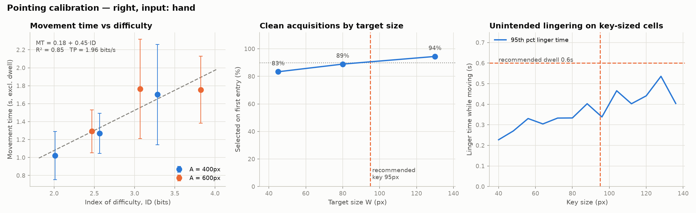
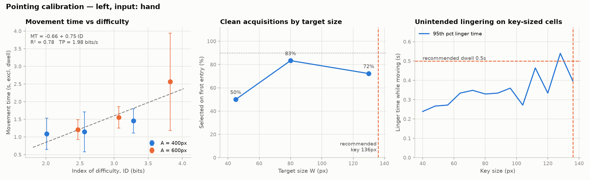
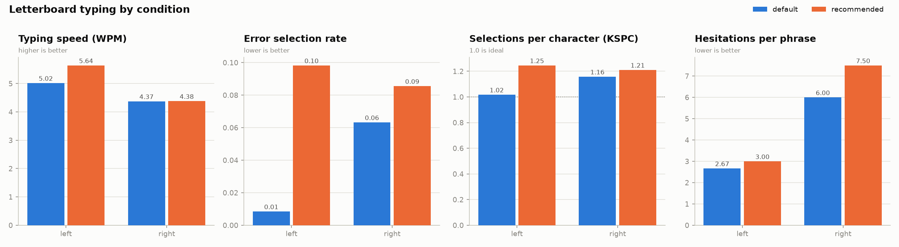

# SteadyDwell

**Personalizing a dwell-based letterboard from a short pointing calibration — using only a webcam.**

SteadyDwell is a small research testbed. A user first completes a ~3-minute pointing task with their index finger, tracked by an ordinary webcam with MediaPipe. From that data the toolkit estimates how large letterboard keys should be and how long the dwell time should be *for that person*, then lets you check whether those settings actually improve typing compared with a default.

## Motivation

Prof. Diwakar Krishnamurthy's lab developed the HoloBoard, an AR letterboard on which nonspeaking people type by pointing at holographic letters (Alabood et al., CHI 2024). The group has since explored other ways to select letters in XR, including gaze (Nazari et al., VRST 2024) and grab-and-release spelling (Alabood et al., DIS 2025), as well as telling intended selections apart from unintended ones (Pratishtha et al., AVI 2026).

Their IEEE Spectrum article (Jaswal, Krishnamurthy & Wang, 2025) describes challenges that motivated this project: users can find motor control difficult, the letterboard's size and color are adjusted by hand, and head-mounted displays are expensive and cannot be worn all day.

This project asks two narrower, technical questions on low-cost hardware:

1. Can a short, standardized pointing task estimate the key size and dwell time a given person needs?
2. Do those personalized settings reduce errors and hesitations compared with a fixed default?

## How it works

```
fitts_task.py        →   analyze_fitts.py        →   collector.py (default vs recommended)   →   analyze_typing.py
3-min pointing task      key size + dwell time        type the same phrases twice                 compare speed, errors, hesitations
```

### 1. Pointing calibration (`fitts_task.py`)

An ISO 9241-411 multi-directional tapping task: 9 circular targets on a ring, selected in alternating order across the ring by dwelling on each one. Six conditions (ring diameter A ∈ {400, 600} px × target size W ∈ {45, 80, 130} px) are presented in random order, with 9 timed selections each.

### 2. Analysis and recommendation (`analyze_fitts.py`)

| Measure | Definition | Used for |
|---|---|---|
| **Fitts' law fit** | MT = a + b·ID, with ID = log₂(D/W + 1) using actual distance D. MT runs from the previous selection to the *last* entry into the target (excluding dwell). Throughput = mean(ID/MT). | Describing overall pointing performance |
| **Clean-acquisition rate** | Share of selections with no timeout and exactly one entry into the target (the cursor did not slip out and come back). | **Key size:** the smallest size reaching 90%, interpolated between tested sizes |
| **Unintended lingering** | An imaginary grid of key-sized cells is overlaid on the screen; for each movement, how long the cursor stays in each cell it passes through (excluding the start and target cells). | **Dwell time:** must exceed the 95th percentile of lingering at the recommended key size, plus 0.1 s, so passing over keys does not trigger them |
| **Hold jitter** | 95th percentile cursor deviation from its own mean during the last half of each dwell, before and after smoothing. | Showing what the One Euro Filter does |

The output is `fitts_report.png` (three panels) and `recommendation.json`.

### 3. Validation on a letterboard (`collector.py`, `analyze_typing.py`)

An 8×4 dwell letterboard (A–Z, SPACE, DEL, SPEAK) whose key size and dwell time are set from the command line. Each selected letter is spoken aloud. After a key is selected, the cursor must leave it before it can be selected again; this prevents accidental repeats while dwelling.

`analyze_typing.py` compares conditions on completed phrases:

- **WPM** = (|T| − 1) / seconds × 60 / 5
- **Error selection rate**: selections that did not match the next correct key
- **KSPC**: selections per character (1.0 is ideal)
- **Hesitations**: dwells abandoned after reaching ≥ 50% progress

## Setup (macOS)

```bash
python3 -m venv .venv
source .venv/bin/activate
pip install -r requirements.txt
curl -L -o hand_landmarker.task \
  https://storage.googleapis.com/mediapipe-models/hand_landmarker/hand_landmarker/float16/latest/hand_landmarker.task
python test_logic.py
```

The first run asks for camera permission for Terminal. Sit about an arm's length from the camera. Every program also accepts `--mouse` for testing without a camera.

## Running a session

```bash
# 1. Calibration (~3 min)
python fitts_task.py --participant P01

# 2. Recommendation (prints the exact command for step 3)
python analyze_fitts.py sessions/fitts_P01_<timestamp>

# 3. Type the same phrases with both settings (alternate which comes first across participants)
python collector.py --participant P01 --condition default
python collector.py --participant P01 --condition recommended --key-size <px> --dwell <s>

# 4. Compare
python analyze_typing.py sessions/typing_*
```

To try the analysis without a camera, `python simulate_fitts.py --tremor 20` generates a **synthetic** calibration session (folders are labeled `SIM`, and plots are marked SYNTHETIC).

## Pilot results (single user)

To get two different levels of pointing precision from one person, the author ran the whole protocol with the **dominant (right)** and then the **non-dominant (left)** hand. For each hand: calibration → typing in ABBA order (default, recommended, recommended, default; 3 phrases per block).

### Calibration

| | Right (dominant) | Left (non-dominant) |
|---|---|---|
| Timeouts | 0 / 54 | 0 / 54 |
| Fitts' law | MT = 0.18 + 0.45·ID, R² = 0.85 | MT = −0.66 + 0.75·ID, R² = 0.78 |
| Throughput | 1.96 bits/s | 1.98 bits/s |
| Clean acquisitions (W = 45 / 80 / 130 px) | 83% / 89% / 94% | 50% / 83% / 72% |
| Hold jitter, 95th pct (raw → smoothed) | 8.9 → 7.8 px | 10.4 → 9.3 px |
| Unintended lingering, 95th pct | 0.40 s | 0.40 s |
| **Recommended key size** | **95 px** | **136 px** (largest that fits) |
| **Recommended dwell** | **0.6 s** | **0.5 s** |




The calibration separated the two hands on **key size**: the left hand was much less likely to acquire small targets on the first try, so it was given the largest key. It did **not** separate them on **dwell time**: lingering was almost identical (0.402 s vs 0.396 s), and the 0.1 s difference in recommended dwell comes entirely from rounding up to the next 0.1 s.

### Typing: default (90 px, 1.0 s) vs recommended

| | WPM | Error selection rate | KSPC | Hesitations / phrase |
|---|---|---|---|---|
| Right, default | 4.37 | 6.3% | 1.16 | 6.0 |
| Right, recommended (95 px, 0.6 s) | 4.38 | 8.6% | 1.21 | 7.5 |
| Left, default | 5.02 | 0.8% | 1.02 | 2.7 |
| Left, recommended (136 px, 0.5 s) | 5.64 | 9.8% | 1.25 | 3.0 |

*Means of two blocks (6 phrases) per cell.*



### What this suggests

- **Right hand:** essentially no difference. The recommended key (95 px) was close to the default (90 px).
- **Left hand:** the recommended settings were about 12% faster but produced roughly ten times more error selections (KSPC 1.25, i.e. about one extra selection for every four characters).
- **The recommended dwell time was too short for typing.** The recommendation changed key size and dwell time together, so this pilot cannot separate their effects. Larger keys should reduce errors, though, which points to the shorter dwell. A likely reason is that the calibration task has **no visual search**: the next target is always the highlighted circle opposite the current one. On a letterboard the user first has to find the next letter, and the finger rests on some key while they look. That pause is longer than the lingering measured during calibration.
- **Learning effects are visible.** The very first block (right hand, default) was the slowest and had the most hesitations. ABBA ordering balances practice within each hand, but the left hand was tested after the right, so the two hands should not be compared directly on WPM.

## Limitations

- **One participant.** The pilot is a single user with typical motor control, using the non-dominant hand as a stand-in for less precise pointing. Nothing here generalizes to the populations that motivate the work.
- **Calibration lacks visual search**, so it underestimates the dwell time needed on a letterboard (see above).
- **Key size and dwell were changed together** in the typing comparison, so their effects are confounded.
- **Recommendations are sensitive to thresholds and rounding.** The key size depends on the 90% clean-acquisition target, and the dwell time is rounded up to 0.1 s.
- **Order and learning effects** remain; more phrases and more participants are needed.

## Files

| File | Purpose |
|---|---|
| `tracking.py` | Webcam (MediaPipe index fingertip) and mouse input |
| `filters.py` | One Euro Filter |
| `fitts_task.py` | Pointing calibration task and logging |
| `analyze_fitts.py` | Fitts analysis, key-size and dwell recommendations, report figure |
| `board.py` | Letterboard layout, hysteresis, dwell state machine with re-arm |
| `collector.py` | Letterboard typing and logging |
| `analyze_typing.py` | Typing comparison across conditions |
| `simulate_fitts.py` | Synthetic calibration data for testing the analysis |
| `plotstyle.py` | Shared chart styling |
| `test_logic.py` | Tests for the selection and task logic (no camera needed) |

## Related work

Work from Prof. Diwakar Krishnamurthy's group and collaborators on XR communication systems motivated this project, including:

- Alabood et al. *From letterboards to holograms: Advancing assistive technology for nonspeaking autistic individuals with the HoloBoard.* CHI 2024.
- Nazari et al. *Evaluating gaze interactions within AR for nonspeaking autistic users.* VRST 2024.
- Alabood et al. *Grab-and-release spelling in XR: A feasibility study for nonspeaking autistic people using video-passthrough devices.* DIS 2025.
- Pratishtha et al. *Detecting intent in XR for nonspeaking autistic typers.* AVI 2026.
- Jaswal, Krishnamurthy & Wang. *The quest to ensure nonspeaking autistic people are heard.* IEEE Spectrum, 2025.

Methods:

- Fitts, P. M. (1954). The information capacity of the human motor system in controlling the amplitude of movement. *Journal of Experimental Psychology*, 47(6).
- MacKenzie, I. S. (1992). Fitts' law as a research and design tool in human-computer interaction. *Human-Computer Interaction*, 7(1).
- Soukoreff, R. W., & MacKenzie, I. S. (2004). Towards a standard for pointing device evaluation, perspectives on 27 years of Fitts' law research in HCI. *International Journal of Human-Computer Studies*, 61(6).
- ISO 9241-411:2012. Ergonomics of human-system interaction — Part 411: Evaluation methods for the design of physical input devices.
- Casiez, G., Roussel, N., & Vogel, D. (2012). 1€ filter: A simple speed-based low-pass filter for noisy input in interactive systems. *CHI 2012*.

The phrases in `phrases.txt` are short, simple sentences written for this pilot; they are not a standard phrase set.

## Acknowledgement

Developed with AI coding assistance (Claude).
